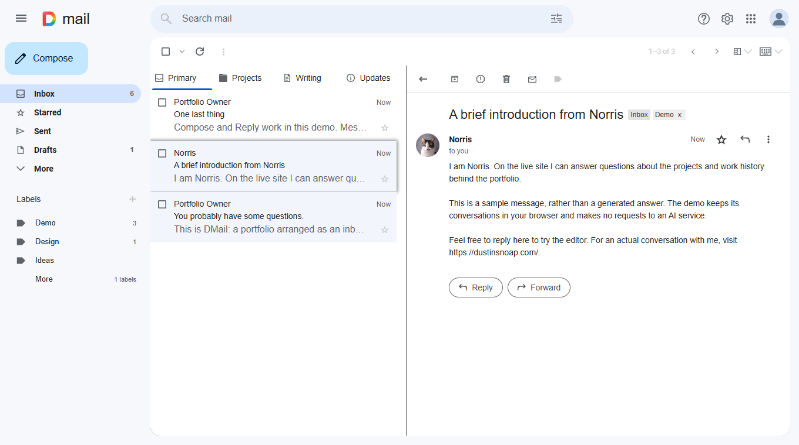

# portfolio-2026-dmail

A portfolio with an inbox. You probably know what to do from here.

**Live demo: [dustinsnoap.com](https://dustinsnoap.com/)**

<a href="https://dustinsnoap.com/">
  <picture>
    <source media="(prefers-color-scheme: dark)" srcset="assets/preview-dark.png">
    
  </picture>
</a>

DMail organizes projects, writing, and updates as conversations. Subjects and previews help you decide what to open; threads leave room for the explanation and whatever happened next. The sample writing series shows five parts in one conversation.

This repository contains the public frontend and a standalone demo with sample content. My portfolio uses the same interface with a separate backend for messaging, accounts, and connected features. That backend is not included here.

## Inside the inbox

- **Browse and read.** Category tabs, expandable conversations, message previews, shareable conversation links, and browser Back/Forward navigation. Introductory messages can arrive as you explore. A reading-progress bar tracks opened conversations and takes you to the next unexplored one.
- **Find things.** Search full messages and earlier replies within the selected section. Use phrases, exclusions, and filters for people, subjects, dates, labels, and attachments, or use the advanced search form.
- **Organize your view.** Stars, read/unread status, custom labels and colors, bulk actions, and familiar Sent, Drafts, Spam, and Trash views. Archive lives under More; restore brings a conversation back to its original section.
- **Write a message.** Compose and Reply share rich-text editing, links, emojis, inline photos, attachments, and browser-native undo/redo where supported. Editable writing templates provide a starting point. Drafts survive navigation within the current page session.
- **Get comfortable.** Light, dark, and system themes, with system selected by default; custom colors; fonts loaded when selected; text-size choices; adjustable density and line spacing; and a reading pane beside or below the inbox, or turned off.
- **Use your preferred controls.** Keyboard shortcuts, accessible dialogs, reduced-motion options, and a responsive mobile layout with a navigation drawer, full-screen conversations, and touch gestures.

## What works without a backend?

| Feature | Standalone repository | Backend-connected portfolio |
| --- | --- | --- |
| Browsing, search, labels, stars, themes, and navigation | Works with bundled sample content and browser preferences. | Works with portfolio content and account synchronization when signed in. |
| Compose and Reply | Saves messages in this browser; nothing is delivered to me. | Saves locally, then synchronizes with the backend for private conversations and email notifications. |
| Attachments and inline photos | Local editing, storage, and supported previews. | Adds uploads and authorized access across devices. |
| Writing suggestions | Editable local templates; no AI service required. | The same local templates. |
| Dictation | Frontend integration is included, but the control is disabled and speech assets are not bundled. | Downloads the speech assets, then transcribes on the visitor's device. |
| Clean up | Frontend integration is included, but the control is disabled; processing is unavailable. | Optional AI editing of a draft, with review and undo before sending. |
| Norris assistant | Sample conversation content; no generated replies. | Contextual answers about the portfolio and career information, with conversation memory and a reset option. |
| Accounts and synchronization | Unavailable. | Sign-in, account creation, recovery, profile images, and conversations and preferences across devices. |
| Email notifications and forwarding | Unavailable. | Owner notifications after fifteen minutes of conversation inactivity; signed-in visitors can forward text to a consenting recipient. Attachments and inline images are excluded. |

In the standalone demo, submitted messages and preferences stay in the current browser; clearing its site data can remove them. Unsent drafts remain in the current page session and do not survive a reload.

The included local server serves the bundled demo; it does not connect to my portfolio's backend. Running this repository does not provide access to the live site's messages or accounts.

## How it works

The interface uses **HTML, CSS, and vanilla JavaScript**, organized into browser modules. There is no frontend framework. `localStorage` retains saved messages and preferences; IndexedDB stores attachment files. Unsent drafts remain in memory. Node.js assembles the HTML and serves the standalone preview. Message bodies load when opened; search loads a separate text index. Compose, settings, and About load when needed. It is not the live messaging backend.

On the live site, **dictation uses Whistle speech recognition through WebAssembly in a browser worker**. The model loads when requested and is cached for later use. Recognition runs on the device, and microphone audio is not uploaded to a transcription service. The hosted speech assets are still required to initialize it; they are separate from this repository.

**Clean up is a separate, optional service.** It sends draft text through the backend to OpenAI to resolve wording and clear self-corrections. It does not send microphone audio or attachment contents, and the result is never submitted as a message automatically. The local writing templates do not use that service.

The live portfolio uses a private **Go backend** for messaging, accounts, and connected features. Norris draws on approved portfolio information through that service. Credentials and access decisions stay on the backend; its source and infrastructure are not included here.

## Try it locally

Use **Node.js 24 or newer**, run **npm start** from the repository folder, and open [localhost:50950](http://localhost:50950).

The standalone preview requires no dependency installation, account, API key, or backend setup. Restart it after editing source files or sample assets.

For development, `npm run check` checks source formatting, syntax, and the browser connection policy. Run `npm install` before using `npm run lint`; those dependencies are development tools.

## Make it yours

The [bundled assets](assets/) include sample conversations, icons, fonts, a sample résumé, and a replaceable profile image. Set the app’s names and profile image in [assets/site.json](assets/site.json). Edit the About panel in [html/panels/about.html](html/panels/about.html). Edit conversations in [assets/data/emails.json](assets/data/emails.json) and [assets/data/writing.json](assets/data/writing.json), and replace the [sample résumé](assets/resume/index.html). See the [asset guide](assets/README.md), then restart the preview.

Connected features need a compatible backend and their associated services. Their frontend controls alone do not provide authentication, email delivery, AI processing, or cloud storage.
